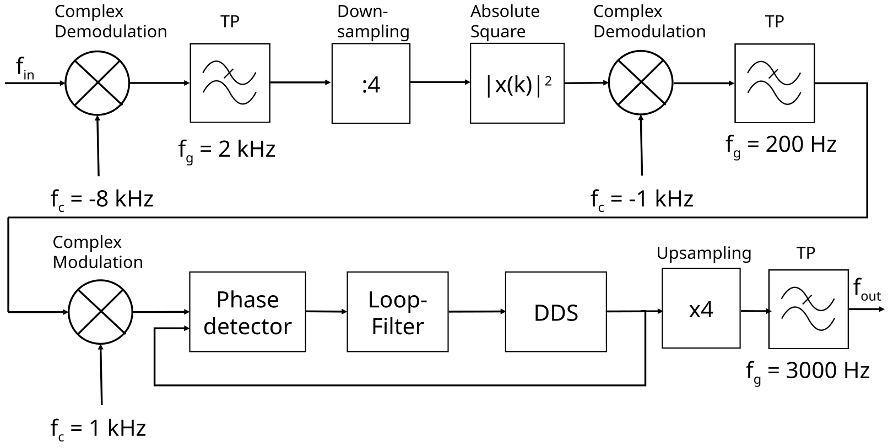

# Digital Phase-Locked Loop (DPLL) for Symbol Timing Recovery in PSK Signals

This project was developed as a digital phase-locked loop for recovering the symbol timing of bandpass-modulated PSK signals, such as BPSK or QPSK. The task was to first analyze and simulate the signal-processing chain in a controlled environment and then implement a real-time embedded solution on dedicated hardware.

The underlying idea is straightforward: a received PSK signal contains the desired information, but it does not necessarily provide a stable and receiver-reconstructed symbol clock. The DPLL estimates the phase and timing error of the signal and generates a locally corrected reference that allows the symbol timing to be recovered.

---

## Project Objective

The system is intended to:

- process modulated PSK signals with an unknown or imperfect symbol timing,
- recover timing information directly from the incoming signal,
- correct the signal phase for synchronization,
- validate symbol timing recovery both in simulation and on hardware.

The project combines two layers:

1. Matlab signal processing: analysis of signal flow, filtering, demodulation, timing-error detection, and loop evaluation.
2. Embedded implementation on the STM32F7508-DK evaluation board: realization using discrete-time signal-processing blocks and circular buffers in a resource-constrained runtime environment.

---

## Signal Processing Chain

The signal-processing chain was initially modeled in Matlab and then progressively transferred to the target architecture. The transition was intentionally made from a classical block-based simulation to a real-time circular filter structure in the embedded implementation.

### 1) Matlab Simulation

During the simulation phase, the entire processing chain was built as a digital signal-processing system:

- input signal with PSK modulation,
- complex demodulation or frequency translation,
- low-pass filtering to separate the useful signal from the carrier component,
- downsampling to reduce the sampling rate,
- magnitude-squared processing to extract timing and phase information,
- complex recovery of the timing signal,
- post-filtering and digital synthesis of the reference.

This allowed the complete control loop to be validated in a controlled environment before porting the design to hardware.

### 2) Transition to Embedded Implementation

The hardware implementation on the STM32F7508-DK followed the same fundamental signal-flow concepts, but had to respect the constraints of a microcontroller application:

- fixed sampling rates,
- limited memory,
- efficient computation without excessive processing load,
- circular buffers instead of block-based offline processing,
- real-time execution capability.

The key conceptual shift was therefore:

- from block-based processing in Matlab to
- circular filtering and stream-processing on the STM32.

This change was necessary because the microcontroller processes data continuously as a stream, rather than as a complete offline data record as in simulation.

---

## Implementation on the STM32F7508-DK

The project was implemented on the STM32F7508-DK evaluation board. The digital signal processing was realized with the available audio and DMA features. Different parts of the processing chain were implemented as numerical calculations, filter stages, and buffering structures:

- signal acquisition via the audio interface block,
- filtering and preprocessing in real time,
- circular buffers for FIR filters and delay lines,
- digital sine/cosine lookup tables for the local phase reference,
- PLL control to generate a timing-synchronized reference frequency,
- output of the controlled signal and the corresponding reference signal.

This part of the project demonstrates the transfer of the mathematical concept into a real embedded system.

---

## Translation of the Block Diagram

The associated block diagram describes the symbol timing recovery signal path. In simple terms, it works as follows:

### Upper Path: Recovery of Symbol Timing Information

1. Input signal
   - The modulated signal with carrier frequency is fed into the system.

2. Complex demodulation
   - The signal is multiplied by a complex reference to remove the carrier frequency or residual frequency offset.
   - This produces a complex baseband signal.

3. Low-pass filter
   - The baseband signal is filtered by a low-pass filter to suppress unwanted high-frequency components.
   - The result is a smoother signal containing the modulation information.

4. Downsampling
   - The sampling rate is reduced so that subsequent processing can run at a lower rate.
   - This makes the computation more efficient.

5. Magnitude-squared operation
   - The signal is squared, or its power is evaluated.
   - This emphasizes the timing information in the signal.

6. Complex demodulation (second mixer)
   - The signal is then mixed again with a complex reference.
   - This extracts the remaining phase and timing information.

7. Low-pass filter
   - A second low-pass filter removes undesired oscillatory components.
   - The output now represents the phase and timing error.

### Lower Path: Reference Synthesis and Control

1. Complex modulation
   - A local reference is generated as a complex sinusoidal signal.

2. Phase detector
   - The phase and timing difference between the input signal and the local reference is determined.

3. Direct digital synthesis
   - A new digital reference is generated from the measured phase error.

4. Upsampling
   - The reference is interpolated to a higher sampling rate.

5. Low-pass filter
   - The synthesized reference is smoothed to ensure a stable timing recovery.

6. Output
   - The result is a reconstructed, phase- and timing-synchronized reference that can be used as the symbol clock for later demodulation.

In summary, the block diagram represents a digital PLL in which the receiver derives the required timing reference directly from the input signal and thereby recovers the symbol clock.

---

## Block Diagram

The signal-processing concept is summarized in the following block diagram, which shows the digital PLL structure used for symbol timing recovery of PSK signals.

### Translation of the labels in the diagram

#### Upper signal path
- Input signal: $f_{in}$
- Complex demodulation
- Low-pass filter
- Down-sampling
- Magnitude-squared operation: $|x(k)|^2$
- Complex demodulation
- Low-pass filter
- Carrier offsets and timing references:
  - $f_c = -8\,\text{kHz}$
  - $f_s = 2\,\text{kHz}$
  - $f_c = -1\,\text{kHz}$
  - $f_s = 200\,\text{Hz}$

#### Lower signal path
- Complex modulation
- Phase detector
- Direct digital synthesis
- Upsampling
- Low-pass filter
- Output signal: $f_{out}$
- Sampling and reference values:
  - $f_c = 1\,\text{kHz}$
  - $f_s = 3000\,\text{Hz}$

### Interpretation of the diagram

The upper path represents the recovery of timing information from the received input signal. The signal is first translated into the complex baseband domain, filtered, downsampled, and processed through a magnitude-squared stage. This creates a signal that strongly emphasizes the timing information. A second complex demodulation and low-pass filtering step then extracts the remaining phase and timing error.

The lower path forms the local reference and control loop. A complex modulator generates a local reference, the phase detector compares it with the recovered timing signal, and direct digital synthesis creates a corrected reference. This reference is then upsampled and filtered to obtain a stable, phase-locked output signal.

This architecture is the digital PLL structure used to reconstruct the symbol clock from the PSK signal itself.

---

## Project Structure

- `Multiplikative_Modulation/`
  - Matlab and simulation files used to analyze multiplicative modulation and signal-processing behavior.

- `Projekt_DS/`
  - STM32 project for the embedded implementation on the STM32F7508-DK board.
  - Contains C source code, HAL configuration files, and hardware project files.

- `Blockschaltbild.png`
  - Visual block diagram of the signal-processing chain.

- `TEL20NT_DSV_Labor_Hepp_Nils_und_Papagno_Fabio_final.pdf`
  - Final report or laboratory document for the project.

---

## Conclusion

This project demonstrates the typical workflow of a practical signal-processing design:

- simulation in Matlab,
- theoretical validation of the signal model,
- transition to a hardware-oriented real-time architecture,
- implementation on an embedded system under real hardware constraints.

The core concept is that the symbol timing of a PSK signal is not recovered only by filtering, but by actively reconstructing the timing reference from the signal itself through phase control. This is exactly what a digital phase-locked loop does.
